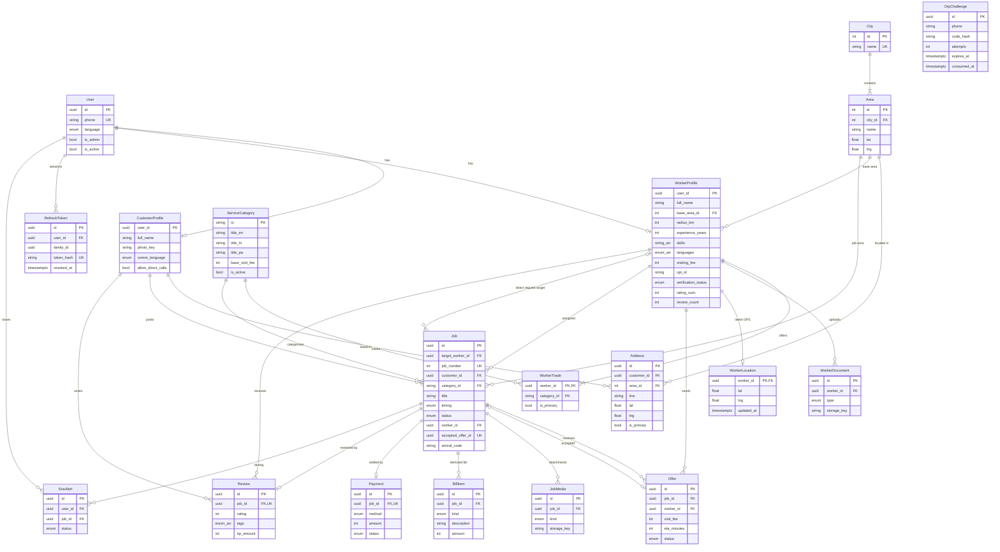

# 02 · Database Architecture

PostgreSQL 16+ (local instance is v18) · Prisma ORM 7.10.x (pin; see §7) · full proposed schema: [`proposed-schema.prisma`](./proposed-schema.prisma).
Every entity below maps to something visible in the app (see `01-requirements.md`). Fields tagged *(gap)* exist because the UI shows the data but never collects it.

## 1. ER diagram



## 2. Entity notes

| Table | Purpose / UI origin | Key decisions |
|---|---|---|
| `users` | One row per phone number | Phone is E.164 and the only identity. `language` is the app language (Language screen). `is_admin` is ❓ A-7 |
| `otp_challenges` | Login OTP | Only a keyed hash of the code is stored; attempts + expiry enforce brute-force limits; rows purged after 24 h |
| `refresh_tokens` | Sessions / logout | Opaque random token, SHA-256 stored; `family_id` enables reuse detection on rotation |
| `customer_profiles` / `worker_profiles` | Onboarding screens | PK = `user_id` (1:1 with user) — no surrogate id, no join needed. A user may have both |
| `addresses` | Customer address + sector chip | Free text `line` is private until assignment. Exactly one primary per customer (partial unique index, §5) |
| `cities`, `areas` | Tricity location chips | Int PKs; `lat/lng` centroid used when no GPS exists (A-5) |
| `service_categories` | 8 trade tiles | String PK = frontend's stable ids (`electrician`, `ac_repair`, …), never renamed. EN/HI/PA titles stored; colours/icon key stay data so the app can drop its hard-coded list |
| `worker_trades` | Trade chips (max 2) | Composite PK; one primary enforced by partial unique index; "max 2" enforced in service + trigger-free count check |
| `worker_documents` | Aadhaar front/back | Only object-storage **keys**. No Aadhaar number column (A-6) |
| `worker_locations` | Live GPS | Latest fix only (upserted); no history because no screen shows one |
| `jobs` | Post-job form + whole fulfilment lifecycle; `target_worker_id` marks a direct booking the target worker must accept (D-3) | One table instead of separate Request/Booking: the UI treats them as the same "job" (`#KC-88421`). Address is **snapshotted** so later profile edits don't rewrite history. `job_number` is a sequence (`KC-<n>`) |
| `job_media` | Voice note, problem photos, before/after photos | `kind` discriminates; voice note carries `duration_sec` |
| `offers` | Quote form | `(job_id, worker_id)` unique; accepting one marks others `REJECTED` |
| `bill_items` | Itemised bill | Platform commission is **not a row**; API always emits `platformFee: 0` |
| `payments` | UPI/Cash "Paid" buttons | 1:1 with job. Records only; `CONFIRMED` is for a future worker confirmation (no UI yet) |
| `reviews` | Rating screen | One per job; `tags` is an enum array; tip is a recorded amount (Q-8) |
| `sos_alerts` | Tracking SOS | Stores who/where/when so the safety desk can act |

Intentionally **not** modelled (not in the UI): wallet balance, notifications inbox, chat, coupons, admin dashboards, worker availability/online toggle ("24 Online" is static text), invoices table (a receipt is generated from job + bill items + payment).

## 3. Derived values (never stored)

| Value | Computation |
|---|---|
| `distanceKm` on cards/leads | Haversine between viewer's point (customer address, else area centroid; worker last fix, else base-area centroid) and the job/worker point |
| `etaMinutes` on tracking | `distanceKm / AVG_SPEED_KMH` (config, 20) rounded up; for direct offers the quoted ETA |
| Worker rating | `ratingSum / reviewCount` (1 decimal; `null` when 0 reviews) |
| `bidsCount` | `COUNT(offers WHERE job_id)` |
| `postedAgo`, "Today at 11:30" | From `created_at`, formatted by the app |
| `urgency` | Mapped from `timing` enum |
| Invoice/booking no. | `KC-${job_number}` |
| Commission saved | `Σ payments.amount × COMMISSION_BENCHMARK_RATE` (D-5) |
| Earned today (worker) | `Σ payments.amount` where `jobs.worker_id = me` and `marked_at` within IST day |

## 4. Indexes (beyond PK/unique)

| Index | Serves |
|---|---|
| `jobs (status, category_id, area_id, created_at)` | Worker lead feed (OPEN jobs per trade/area) |
| `jobs (customer_id, status, created_at)` | Customer Activity tabs |
| `jobs (worker_id, status, created_at)` | Worker Activity tabs, earnings |
| `jobs (status, expires_at)` | Expiry sweeper |
| `offers (worker_id, status)` · unique `(job_id, worker_id)` | Worker's own quotes; duplicate protection |
| `worker_profiles (base_area_id, verification_status)` | Discovery + lead fan-out |
| `worker_trades (category_id)` | Discovery by trade |
| `reviews (worker_id, created_at)` | Worker profile reviews |
| `payments (marked_at)` | Earnings / savings aggregates |
| `otp_challenges (phone, created_at)` | Cooldown + rate-limit lookups |
| `sos_alerts (status, created_at)` | Safety-desk queue |

No PostGIS in v1 (A-5): Tricity-scale haversine over an area-pre-filtered set is cheap. Revisit if worker count > ~50k or radius search needs ordering by true distance in SQL.

## 5. Constraints Prisma can't express (hand-written in the first migration)

```sql
-- Money and ranges
ALTER TABLE offers          ADD CONSTRAINT offers_fee_pos       CHECK (visit_fee > 0 AND visit_fee <= 100000);
ALTER TABLE offers          ADD CONSTRAINT offers_eta_range     CHECK (eta_minutes BETWEEN 5 AND 240);
ALTER TABLE bill_items      ADD CONSTRAINT bill_amount_nonneg   CHECK (amount >= 0);
ALTER TABLE payments        ADD CONSTRAINT pay_amount_pos       CHECK (amount > 0);
ALTER TABLE reviews         ADD CONSTRAINT review_rating_range  CHECK (rating BETWEEN 1 AND 5);
ALTER TABLE reviews         ADD CONSTRAINT review_tip_nonneg    CHECK (tip_amount >= 0);
ALTER TABLE worker_profiles ADD CONSTRAINT wp_radius_allowed    CHECK (radius_km IN (3, 6, 12));
ALTER TABLE worker_profiles ADD CONSTRAINT wp_exp_range         CHECK (experience_years BETWEEN 1 AND 40);

-- One primary address per customer; one primary trade per worker
CREATE UNIQUE INDEX addresses_one_primary ON addresses (customer_id) WHERE is_primary;
CREATE UNIQUE INDEX worker_trades_one_primary ON worker_trades (worker_id) WHERE is_primary;

-- State coherence
ALTER TABLE jobs ADD CONSTRAINT jobs_assigned_has_worker
  CHECK (status IN ('OPEN','CANCELLED') OR worker_id IS NOT NULL);

-- Human-friendly job numbers start at 10000 (UI shows KC-88421 style numbers)
ALTER SEQUENCE jobs_job_number_seq RESTART WITH 10000;
```

(Prisma 8 can declare partial indexes in-schema; we stay on Prisma 7 so they live in SQL migrations. They survive `migrate dev` as long as they are in the migration files.)

## 6. Integrity rules enforced in code (inside a transaction)

| Rule | Mechanism |
|---|---|
| Accept offer: only if job is `OPEN`, offer is `PENDING`, caller owns job | `updateMany({where:{id, status:'OPEN'}})` and check `count === 1`; then set sibling offers `REJECTED` — all in one `$transaction` |
| One offer per worker per job | Unique index → map `P2002` to `409` |
| Worker must be `VERIFIED` and have the job's category as a trade to quote | Service check |
| State transitions | A pure `JobStateMachine` table (from → to, allowed actor) used by every mutation; illegal transition ⇒ `409` |
| Review aggregates | `ratingSum += rating; reviewCount += 1` as atomic increments in the same transaction as the review insert |
| Max 2 trades | DTO `@ArrayMaxSize(2)` + service re-check on write |
| Bill editable only while `ARRIVED` (before approval) | State check; approval snapshots the total |
| Payment amount = Σ bill items | Computed server-side, client sends only the method |

## 7. Version pinning (important)

Verified against npm/Prisma docs on 2026-10-10:
- Prisma ORM **7.10.x is the stable line**; **Prisma 8 is still a release candidate** (final expected Oct 2026).
- `npm install prisma` currently resolves to the **8.0 RC CLI, which does not read `schema.prisma` and has no `generate`/`migrate dev`/`db push`**. The project must pin `prisma@7.10.0` and `@prisma/client@~7.10` exactly.
- Prisma 7 specifics we will follow: `prisma.config.ts` holds the datasource URL and the `migrations.seed` command; `generator client { provider = "prisma-client" }` with an explicit `output`; PostgreSQL via the `@prisma/adapter-pg` driver adapter; `.env` is not auto-loaded (load `dotenv` in the config); `migrate dev` does not auto-run seeds.
- Re-evaluate Prisma 8 after GA; the migration guide supports running 7 and 8 side by side.
